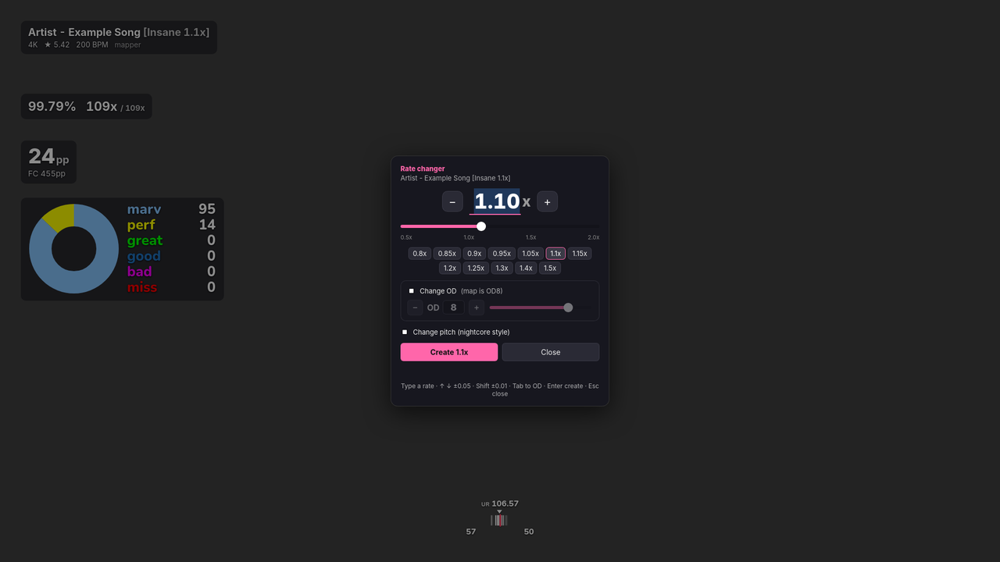

# mania-overlay

An in-game overlay for **osu!mania** (osu! stable under Wine) on **Linux Wayland**, made for **KDE Plasma** and **niri** on **Fedora**.



- **Judgement counter**: a doughnut chart of your judgement split next to marv / perf / great / good / bad / miss counts, in the style of breadles5's [Mania Hit Count and Chart](https://github.com/breadles5/Mania-Hit-Count-and-Chart). Can also show counts only or one line, with optional MA / PA ratios and an MA / PFC / FC badge.
- **PP**: live pp and FC pp while playing, SS pp in song select, final pp on the results screen
- **Hit error bar**: slim and see-through, with fading ticks, a centre line, an arrow for your average and **early / late counts** (can be turned off). It also shows UR, and judgement colours if you want them.
- **Accuracy / combo** and **map info** (keys, stars, BPM, rate)
- **MSD and dan estimates** from [ManiaMapAnalyser](https://github.com/LeoBlackMT/osumania_map_analyser) (MinaCalc MSD, skillsets, 4K/6K/7K RC/LN dans), drawn at full resolution at any size
- **Rate changer**: makes a copy of the selected map at any rate from 0.5x to 2x, with or without pitch change, and can **change the map's OD** too (or only the OD)
- **Editor**: drag widgets anywhere, resize them, choose when each one shows, pick the monitor, change colours and fonts. Everything saves automatically.
- **Click-through**: it draws above fullscreen osu!, but every click and key goes to the game

## Install (Fedora)

```bash
git clone https://github.com/GabrielRnkovic/mania-overlay.git
cd mania-overlay
./install.sh
```

Or without cloning:

```bash
bash <(curl -fsSL https://raw.githubusercontent.com/GabrielRnkovic/mania-overlay/main/install.sh)
```

The installer asks whether you use **KDE Plasma** or **niri**, then sets up everything, even on a fresh system:

| Step | What it does |
| --- | --- |
| System packages | `dnf install`s GTK 4, gtk4-layer-shell, WebKitGTK 6, PyGObject and ffmpeg (only what's missing; sudo asks for your password) |
| osu! | Looks for an [osu-winello](https://github.com/NelloKudo/osu-winello) install and offers to run osu-winello if osu! isn't found (default: no) |
| tosu | Downloads the latest Linux [tosu](https://github.com/tosuapp/tosu) release to `~/.local/share/mania-overlay/tosu`. tosu reads live data from osu!. |
| ManiaMapAnalyser | Downloads the plugin-only release into tosu's counters folder (`~/.local/share/tosu/static`) |
| mania-overlay | Copies the app to `~/.local/share/mania-overlay` and links `~/.local/bin/mania-overlay` |
| Start on login | systemd user services `mania-overlay-tosu` and `mania-overlay`, started with your Plasma or niri session (if niri isn't run as a systemd session, `spawn-at-startup` lines in `mania-overlay.kdl` instead) |
| Shortcuts | **KDE:** registers global shortcuts with Plasma (they show up in System Settings). **niri:** writes `~/.config/niri/mania-overlay.kdl` and adds one `include` line to your `config.kdl`. |

You don't have to edit any config files. Re-run `./install.sh` any time to update; your layout and settings are kept, and it remembers your answers. `./install.sh --help` lists the options (`--desktop kde|niri`, `--yes`, `--no-tosu`, …).

**Already running tosu yourself?** Answer *no* to the tosu question, and keep starting yours as before.

### What the installer changes in your niri config

It backs up `config.kdl` (to `config.kdl.mania-backup-<date>`), appends

```kdl
// Added by mania-overlay (remove both lines to drop its shortcuts)
include "mania-overlay.kdl"
```

and checks the result with `niri validate`. If niri rejects it, the backup is restored. If you added mania-overlay binds by hand before, it offers to comment those lines out. Includes need **niri 25.11 or newer**. On older niri it prints the lines to paste instead.

## Using it

| KDE Plasma | niri | What it does |
| --- | --- | --- |
| Meta+Alt+O | Mod+Alt+O | Open / close the **editor** |
| Meta+Alt+R | Mod+Alt+R | **Rate changer** popup |
| Meta+Alt+H | Mod+Alt+H | Show / hide the overlay |
| Meta+Alt+1 / 2 | Mod+Alt+1 / 2 | Make a 1.1x / 1.2x copy of the selected map right away |

**Changing the keys.** On KDE, use *System Settings → Keyboard → Shortcuts → mania-overlay*. On niri, edit `~/.config/niri/mania-overlay.kdl`, or bind the same commands in `config.kdl`. Re-running the installer overwrites `mania-overlay.kdl`.

### Editor

- Drag a widget to move it. It snaps to a grid; hold **Shift** to move freely.
- Scroll over a widget to resize it, or nudge it with the arrow keys (**Shift** moves 10 px).
- **General → Monitor** chooses which screen the overlay is on. The change applies immediately.
- **Esc** or **Done** closes the editor.

### Rate changer

Select a map in song select, then press **Meta/Mod+Alt+R**:

- Type a rate (a comma works as the decimal mark), drag the slider, or use **↑ / ↓** for ±0.05 (**Shift**: ±0.01).
- Tick **Change OD** to set a new OD from 0 to 10. With a rate of 1.00x, this makes an OD-only copy with the original timing and audio.
- **Enter** creates the copy, **Esc** closes the popup.

Each copy goes into the same mapset, for example `[Insane 1.15x]`, `[Insane 1.1x OD8]` or `[Insane OD9]`. Timestamps are divided by the rate and BPM is multiplied by it; scroll speed (SV) is unchanged. The audio is re-encoded with ffmpeg, keeping the pitch unless you tick *Change pitch*. `BeatmapID` is set to 0 so the copy doesn't clash with the ranked difficulty. Press **F5** in song select if a new difficulty doesn't show up.

The editor's *Rate changer* tab can make several rates at once, and there's a command line too:

```bash
mania-overlay rate 1.1 1.2            # copies of the map selected in osu!
mania-overlay rate 1.1 --od 8         # rate and OD
mania-overlay rate 1 --od 9           # OD only
mania-overlay rate-file "path/to/map.osu" 1.15 --pitch   # a specific file, no overlay needed
```

### All commands

| Command | |
| --- | --- |
| `mania-overlay` | start the overlay (the installer does this on login) |
| `mania-overlay edit` / `rate-menu` / `toggle` / `show` / `hide` | control a running overlay |
| `mania-overlay reload` / `quit` | reload the page / stop |
| `mania-overlay run --inspect` | start with the WebKit inspector (right-click in the editor) |
| `mania-overlay run --demo` | fake gameplay data, for trying it without osu! |

Settings live in `~/.config/mania-overlay/settings.json`.

## How it works

```
osu! (Wine) ──memory──▶ tosu ──websocket──▶ overlay page (widgets)
                          └── serves ManiaMapAnalyser ──▶ second WebView, real page zoom
mania-overlay (Python): GTK 4 layer-shell window + WebKitGTK, local API on 127.0.0.1:24055
```

The overlay is a transparent full-screen **wlr-layer-shell** surface on the *overlay* layer, so it sits above fullscreen osu! on KWin and niri (and other wlroots compositors). Its input region is empty, so input passes through to the game. In the editor and the rate changer it takes the keyboard and mouse.

ManiaMapAnalyser is a separate tosu counter. Scaling it with CSS made WebKit stretch a 1x bitmap, which is why it looked blurry. It is now drawn by its own WebView using WebKit's real page zoom, so text and graphs stay sharp at any size. The editor still shows an in-page preview, so the panel can't cover the settings window.

## Uninstall

```bash
./install.sh --uninstall
```

This stops and removes the services, the shortcuts (including the niri `include` line, after a backup), the app and the tosu copy it installed. It asks before deleting your overlay settings or the ManiaMapAnalyser counter. System packages are left installed.

## Troubleshooting

- **Logs**: `journalctl --user -u mania-overlay -u mania-overlay-tosu`, or stop the service (`systemctl --user stop mania-overlay`) and run `mania-overlay` in a terminal.
- **Nothing shows over osu!**: open the editor (Meta/Mod+Alt+O) and check the bottom-left corner says *tosu connected*. If it doesn't, check http://127.0.0.1:24050 in a browser.
- **The overlay is on the wrong screen**: *Editor → General → Monitor*.
- **A shortcut does nothing**: the key may already be in use. On KDE, pick another key in System Settings → Shortcuts → mania-overlay; on KDE 6.0 or older, new shortcuts only work after logging out and back in. On niri, check `niri validate` and `~/.config/niri/mania-overlay.kdl`.
- **"doesn't support wlr-layer-shell"**: you're in an X11 session. Log in with *Plasma (Wayland)* or niri.
- **tosu can't read osu!**: check `cat /proc/sys/kernel/yama/ptrace_scope`. If it's 1 or higher, the installer gives tosu the `cap_sys_ptrace` capability; re-run it after changing that setting.
- **The rate changer can't find the map**: set *Editor → General → Songs folder* (osu-winello: `~/.local/share/osu-wine/osu!/Songs`).
- **Black or empty overlay (often NVIDIA)**: add `Environment=WEBKIT_DISABLE_DMABUF_RENDERER=1` with `systemctl --user edit mania-overlay`, then `systemctl --user restart mania-overlay`.
- **MSD panel empty or "ENOENT"**: the counter folder must be exactly `~/.local/share/tosu/static/ManiaMapAnalyser by Leo_Black`. Re-running the installer fixes it.

## Development

```bash
python3 -m unittest discover tests      # rate changer, OD and path tests
python3 dev/preview_server.py           # page only, in a normal browser: http://127.0.0.1:24055/?demo&edit
./mania-overlay run --demo              # the real overlay with fake data
```

In demo mode, F2 toggles the editor and F3 toggles the rate changer.

## Credits

- [tosu](https://github.com/tosuapp/tosu) reads osu!'s memory and serves the counters.
- [ManiaMapAnalyser](https://github.com/LeoBlackMT/osumania_map_analyser) by Leo_Black provides the MSD and dan panel. It sends anonymous usage stats by default; you can turn that off in its settings (tosu dashboard → the counter → *Network*).
- [gtk4-layer-shell](https://github.com/wmww/gtk4-layer-shell) puts the GTK window on the overlay layer.
- The judgement counter's design (chart + coloured counts, colours) follows breadles5's [Mania Hit Count and Chart](https://github.com/breadles5/Mania-Hit-Count-and-Chart). It's a reimplementation; none of its code or files are included.
- [Nunito](https://github.com/googlefonts/nunito) (SIL Open Font License, `web/fonts/Nunito-OFL.txt`) is the rounded font. If you have Visby Round CF installed, which the original counter uses, it's used instead.

Both tosu and ManiaMapAnalyser are downloaded from their own GitHub releases by the installer; neither is bundled here.

## License

MIT, see [LICENSE](LICENSE).
